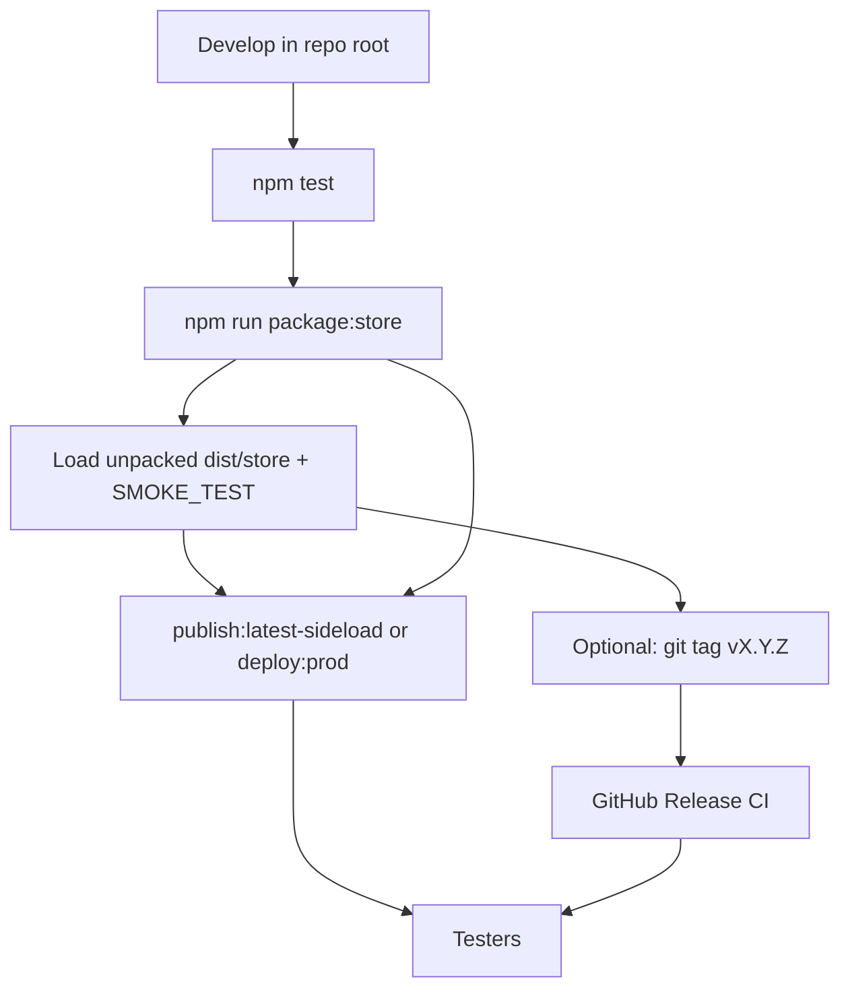

# Extension builds, ZIPs, and releases — overview

This page is the **maintainer map** for how RAG Moderation Assistant moves from day-to-day development to tester ZIPs, the public download site, GitHub Releases, and (eventually) the Chrome Web Store. Detailed steps live in linked docs; use this file when you want the whole story in one place.

## Table of contents

- [Three ways people run the extension](#three-ways-people-run-the-extension)
- [What one `package:store` run does](#what-one-packagestore-run-does)
- [Where testers download ZIPs](#where-testers-download-zips)
- [Recommended maintainer flows](#recommended-maintainer-flows)
- [Publish extension guides (Flow C — Markdown → site)](#c-public-guides-only-no-new-zip)
- [Flow diagram (sideload + site)](#flow-diagram-sideload--site)
- [Document index (drill-down)](#document-index-drill-down)
- [Repo commands (quick reference)](#repo-commands-quick-reference)

---

## Three ways people run the extension

| Mode | What they load | API profile | Primary doc |
|------|----------------|-------------|-------------|
| **Development** | Repo root (`Load unpacked`) | Local / Custom / Production in Options | [README](../README.md), [SMOKE_TEST.md](./SMOKE_TEST.md) |
| **Sideload (testers)** | Unzipped **store-shaped** build | Production only (locked) | [RELEASE.md](./RELEASE.md), [install (developer)](https://www.airesearchdog.net/extension/install-chrome-extension-developer) |
| **Store (future)** | Same ZIP as sideload, installed from Chrome / Edge stores | Production | [STORE_CHECKLIST.md](./STORE_CHECKLIST.md), [STORE_PACKAGING.md](./STORE_PACKAGING.md) |

Sideload and store builds share one packager: **`npm run package:store`**. That command is the hinge for almost every ZIP you ship.

---

## What one `package:store` run does

From **rag-moderation-extension**:

```bash
npm test
npm run package:store
```

It builds a **store-shaped tree** and ZIP, then updates **on-site download artifacts** (not only `dist/`):

| Output | Where | In git? |
|--------|--------|---------|
| `dist/store/` | Extension repo | No (`dist/` ignored) — use for **Load unpacked** QA |
| `dist/rag-moderation-assistant.zip` | Extension repo | No — upload to stores / attach to releases |
| `docs/data/latest-release.json` | Extension repo | **Yes** — version, SHA256, paths for the public page |
| `get-latest-extension.html` (synced) | Universal `public/extension/` | Yes (HTML only) |
| `rag-moderation-assistant.zip` (+ versioned copy) | Universal `public/extension/downloads/` | **No** — gitignored; must exist on disk before Vercel deploy |

Packager behavior (manifest, exclusions, store Options UI): [STORE_PACKAGING.md](./STORE_PACKAGING.md).

Optional checks:

```bash
npm run verify:store-zip
npm run print:release-zip-sha256
```

For a tagged release build locally: `RELEASE_VERSION=X.Y.Z npm run package:store`.

---

## Where testers download ZIPs

You maintain **two distribution channels**. They are related but **not automatically kept in sync**.

### On-site (airesearchdog.net)

- **Page:** [get-latest-extension](https://www.airesearchdog.net/extension/get-latest-extension) — version, SHA256, install links  
- **File:** `/extension/downloads/rag-moderation-assistant.zip`  
- **Source copy:** [GET_LATEST_EXTENSION.md](./GET_LATEST_EXTENSION.md) → sync script  

**Updating production** requires a **manual** package + deploy. GitHub tag CI does **not** push the ZIP to Vercel.

**From extension repo (all-in-one):**

```bash
npm run publish:latest-sideload
```

That runs `package:store`, `sync:public-guides`, and Universal `deploy:prod` (Vercel must be logged in; ZIP must be present under Universal `public/extension/downloads/`).

**Or step by step:**

1. **rag-moderation-extension:** `npm run package:store`  
2. **Moderation-Tool-Universal:** `npm run deploy:prod` (runs `verify-extension-download-artifacts` first)

Production smoke:

```bash
curl -fsI "https://www.airesearchdog.net/extension/get-latest-extension" | head -1
curl -fsI "https://www.airesearchdog.net/extension/downloads/rag-moderation-assistant.zip" | head -1
```

Compare downloaded ZIP SHA256 to `docs/data/latest-release.json`.

Full write-up: [RELEASE.md § Ship on-site sideload download](./RELEASE.md#ship-on-site-sideload-download-production).

### GitHub Releases (tagged CI)

- **URL:** [releases/latest](https://github.com/tompearson/rag-moderation-extension/releases/latest)  
- **Trigger:** push annotated tag `vX.Y.Z` → [release.yml](../.github/workflows/release.yml)  
- **Asset:** `rag-moderation-assistant-<version>.zip` + SHA256 in release notes + optional Resend email  

Cut-a-release checklist: [RELEASE.md § For maintainers](./RELEASE.md#for-maintainers--cut-a-release).

**Important:** After a GitHub release, run the **on-site** flow above if testers should get the same build from airesearchdog.net without using GitHub.

---

## Recommended maintainer flows

### A. New sideload for testers (no semver tag yet)

1. Merge to `master`, CI green  
2. `npm test` → `npm run package:store`  
3. QA: **Load unpacked** → `dist/store/`, [SMOKE_TEST.md](./SMOKE_TEST.md) (production profile)  
4. `npm run publish:latest-sideload` (or deploy steps above)  
5. Share [get-latest-extension](https://www.airesearchdog.net/extension/get-latest-extension)  
6. Commit `docs/data/latest-release.json` (and any doc changes) when the published metadata should match git  

### B. Formal version on GitHub + email

1. Complete flow **A** (or at least `package:store` locally) so you trust the tree  
2. Bump version in [packaging/manifest.store.json](../packaging/manifest.store.json) if needed  
3. Tag and push: `git tag -a vX.Y.Z -m "vX.Y.Z"` → `git push origin vX.Y.Z`  
4. Wait for Release workflow; share GitHub asset + notes  
5. If the site should match: **`publish:latest-sideload`** (or package + deploy) with the same version  

### C. Public guides only (no new ZIP)

Markdown in `docs/*.md` → Universal HTML:

```bash
npm run sync:public-guides   # or a single sync:* script
cd ../community-moderation-tool/Moderation-Tool-Universal
npm run deploy:prod
```

Note: Universal `deploy:prod` **requires** sideload ZIP + `get-latest-extension.html` on disk (verify script). If you only changed unrelated HTML, either keep the last packaged ZIP in `downloads/` or run `package:store` first.

Local preview without deploy: [DEV_WEB_DOCS.md](./DEV_WEB_DOCS.md).

### D. Chrome Web Store / Edge (when listed)

Same **`dist/rag-moderation-assistant.zip`** as sideload. Pre-submit: [STORE_CHECKLIST.md](./STORE_CHECKLIST.md), auth: [PROD_AUTH_SPIKE.md](./PROD_AUTH_SPIKE.md), Edge notes: [EDGE_PORT.md](./EDGE_PORT.md).

---

## Flow diagram (sideload + site)



---

## Document index (drill-down)

| Topic | Document |
|-------|----------|
| Tag releases, tester install, on-site deploy commands | [RELEASE.md](./RELEASE.md) |
| What the ZIP contains, packager inputs, local QA | [STORE_PACKAGING.md](./STORE_PACKAGING.md) |
| Web Store listing checklist, URLs, permissions | [STORE_CHECKLIST.md](./STORE_CHECKLIST.md) |
| Public download page (markdown source) | [GET_LATEST_EXTENSION.md](./GET_LATEST_EXTENSION.md) |
| Preview `/extension/*` on :3000 | [DEV_WEB_DOCS.md](./DEV_WEB_DOCS.md) |
| End-to-end moderation smoke | [SMOKE_TEST.md](./SMOKE_TEST.md) |
| Production OAuth before public store | [PROD_AUTH_SPIKE.md](./PROD_AUTH_SPIKE.md) |
| Sync extension Markdown → Universal HTML | [VENDORED_FROM_UNIVERSAL.md](./VENDORED_FROM_UNIVERSAL.md) |

---

## Repo commands (quick reference)

**rag-moderation-extension**

| Command | Purpose |
|---------|---------|
| `npm run package:store` | Build ZIP + `latest-release.json` + copy to Universal + sync get-latest HTML |
| `npm run publish:latest-sideload` | Package + all public guide syncs + Universal production deploy |
| `npm run sync:public-guides` | Regenerate all extension HTML in Universal |
| `npm run sync:get-latest-extension-guide` | Regenerate get-latest page only (needs `latest-release.json`) |

**Moderation-Tool-Universal**

| Command | Purpose |
|---------|---------|
| `npm run deploy:prod` | Verify sideload artifacts, then `vercel --prod` |
| `npm run dev:extension-guides` | Vite preview at `/extension/...` |

Sibling path override: `SYNC_UNIVERSAL_DIR` / `DEV_UNIVERSAL_DIR` when Universal is not the default checkout.
